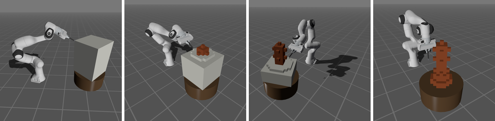
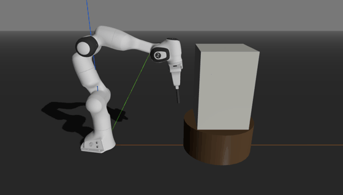
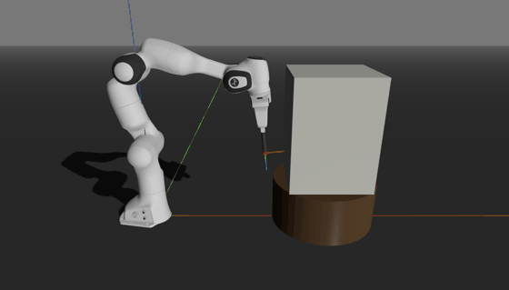
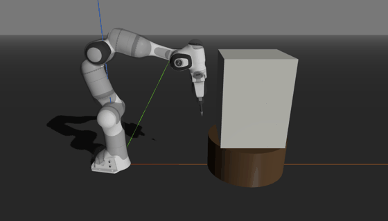
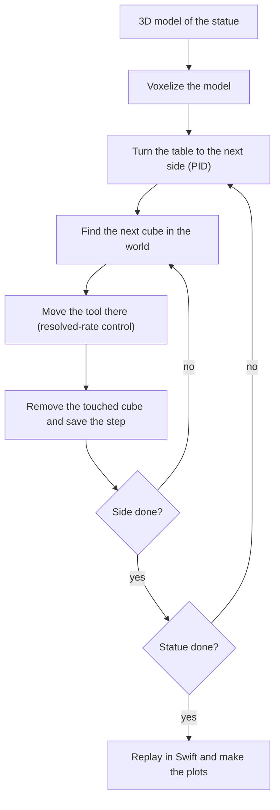

# Sculptor Robot

<p align="center">
  
</p>

A Panda arm carves a statue out of a marble block that sits on a rotating table. Everything is simulated, with Python and the Robotics Toolbox for the control and Swift for the 3D view.

Midterm project of *Robot Control Applications* (SUPSI). Work in progress.

<table>
  <tr>
    <td width="33%"></td>
    <td width="33%"></td>
    <td width="33%"></td>
  </tr>
  <tr>
    <td>Cubes removed by their id (notebook 00)</td>
    <td>The block turns with the table (notebook 01)</td>
    <td>The arm at each cube of the carving order (notebook 03)</td>
  </tr>
</table>

## Carving loop

The block is made of small cubes (voxels). We take a 3D model of the statue, and every voxel that is not part of it has to go. The robot touches those voxels one by one and they disappear. The table turns, so the robot always works on the side in front of it.



**1. Voxelize.** The model is scaled to the block and turned into cubes. Block minus statue = the cubes to remove.

**2. Turn the table.** A PID moves the table to the angle of the next side. The arm waits until the table stops.

**3. Find the cube.** Each cube is known in the block frame. With the table rotated by $\varphi$, in the world it is:

$$\mathbf{p}^W = \mathbf{T}^W_{T}\,\mathbf{R}_z(\varphi)\,\mathbf{p}^B$$

**4. Move the tool.** Closed-loop resolved-rate control drives the tool to the cube. The Panda has more joints than the task needs, so a second task in the null space keeps its posture from drifting:

$$\dot{\mathbf{q}} = \lambda \mathbf{J}^+ (\mathbf{x}^\ast - \mathbf{k}(\mathbf{q})) + (\mathbf{I} - \mathbf{J}^+\mathbf{J})\, k_0 (\mathbf{q}_r - \mathbf{q})$$

**5. Remove and save.** When the point of the chisel is inside the cube, the cube is removed and the step is saved (joints, table angle, removed cubes).

**6. Replay and compare.** The simulation runs without Swift, then the saved steps are played back in Swift. Running it with different settings (open or closed loop, noise on the joints, posture task on or off) gives the comparisons for the report.

## Design choices

Each choice was measured in a notebook before fixing it in `src/sculptor/`.

| Choice | Measurement | Notebook |
|--------|-------------|----------|
| Cubes of 0.03 m | Slowest step 0.0191 s with 1500 cubes, under the 0.05 s each step stands for; 0.0556 s with the 4950 cubes of 0.02 m | 00 |
| Chisel tilted 30 degrees down | A horizontal chisel reaches 0.68 of the profile of the block, and from 20 degrees down it reaches 1.00 | 03 |
| Statue 0.42 m tall | The arm reaches every cube up to 0.54 m; Swift sets the limit, with 1815 cubes at 0.42 m against 3211 at 0.54 m | 03 |
| Top layer first, outside in | 8 of 1605 marble cubes blocked by the chisel, against 1589 in the reverse order | 03 |
| Table turns between 4 sides | The table turns 59 times instead of 1603, with the same 8 blocked cubes; 8 sides block 86 | 04 |

## Folders

```
sculptor-robot/
├── src/sculptor/   # modules shared by the notebooks
├── notebooks/      # one notebook per step, run in order
├── html/           # the notebooks exported to HTML, to read them without Python
├── models/         # 3D models of the statues, and the tip of the chisel
├── results/        # results that take long to compute, one folder per notebook, and the recordings
└── docs/           # report, slides, images
```

Modules in `src/sculptor/` (they are added step by step):

| Module | Content |
|--------|---------|
| `scene.py` | Drawing the table, the block and the chisel in Swift, recording scenes as GIFs, and `fix_mesh_paths` so Swift loads meshes on Windows |
| `cell.py` | Frames of the cell (table, block, chisel tip), the tilt and the sizes of the chisel, and the table PID |
| `model.py` | The block as voxels, the proxy pawn and the height of the statue |
| `collision.py` | Sphere hitboxes of the arm, the hand and the chisel, and which cube the point of the chisel is in |
| `controller.py` | Resolved-rate control of the arm |
| `carving.py` | The carving order, the carving simulation and its saved steps |

## How to reproduce

**Environment.** The environment is the same as the course one (`rca`), plus `trimesh` for the 3D models and `pandas` for the tables. With [uv](https://docs.astral.sh/uv/):

```bash
uv sync
```

This creates `.venv` and installs `sculptor`, so the notebooks can just `import sculptor`. The notebooks are saved with a kernel called `sculptor-robot`, which runs the Python of `.venv`. Register it once:

```bash
uv run python -m ipykernel install --sys-prefix --name sculptor-robot --display-name sculptor-robot
```

In VS Code it then shows up in **Select Kernel** → **Jupyter Kernel**.

If you prefer to keep working with the course environment, install the project into it instead (the path is where your `rca` venv lives):

```bash
uv pip install --python path/to/rca -e .
```

This adds `sculptor`, `trimesh` and `pandas` and nothing else (`pillow`, used for the GIFs, already comes with matplotlib). With `-e`, changes in `src/` are picked up without installing again (restart the kernel after a change). With this route, pick `rca` as the kernel instead of `sculptor-robot`.

On Windows, Swift cannot load meshes out of the box. The notebooks fix this in their setup with `fix_mesh_paths()`, so there is nothing to patch by hand.

**Notebooks.** Run them in order. Swift opens a tab in the default browser. Each notebook is also exported to `html/` after running it from scratch.

| Notebook | What it does | Time |
|----------|--------------|------|
| `00_swift_prototype` | Measures how many cubes the Swift scene can hold, to choose the cube size | about 1 min |
| `01_cell_frames` | Checks the frames of the table and the block, and shows the cell in Swift with a pawn | under 1 min |
| `03_reachability` | Finds the tilt of the chisel and the height of the statue the arm can reach, and checks the hitboxes against the cubes in the carving order | about 2 min |
| `04_arm_control` | Chooses the sides of the block and compares resolved-rate controllers for the chisel tip (in progress) | under 1 min |

The timings in `00_swift_prototype` depend on the machine and the browser; they were measured on an Intel Core i7-14700HX with 16 GB of RAM, Windows 11 and Firefox.

**Saved results.** Results that take long to compute will be saved in `results/<notebook>/`, and each notebook will have a flag in its setup to compute them again.

**Recordings.** The Swift scenes are recorded as GIFs in `results/recordings/`, named after their notebook (`01_cell_frames_turn.gif`), and shown in the notebooks and in their HTML export. A notebook records a scene only when its GIF is missing or when `RECORD = True` in its setup; otherwise it shows the saved one. Swift can only save a recording through a browser download, so recording needs the browser to save downloads to `~/Downloads` without asking (the default in Firefox), and the Swift tab has to stay on screen, since the browser stops drawing a tab it does not show. `recording` in `scene.py` takes another folder if your downloads go elsewhere.

## License

MIT, see [LICENSE](LICENSE).
