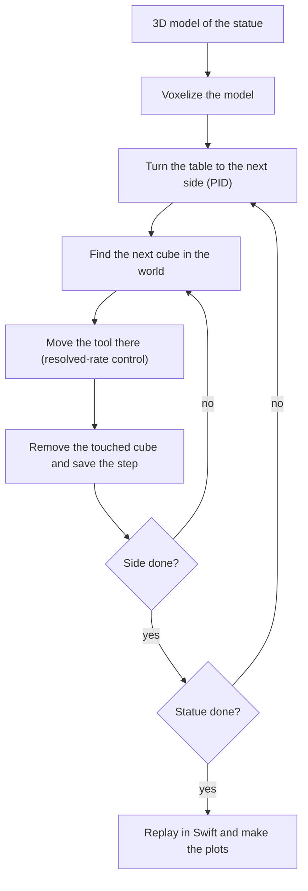

# Sculptor Robot

A Panda arm carves a statue out of a marble block that sits on a rotating table.

Everything is simulated, with Python and the Robotics Toolbox for the control and Swift for the 3D view.

Midterm project of *Robot Control Applications* (SUPSI). Work in progress.

<!-- TODO: short looping GIF of the robot carving (docs/media/) -->

## How it works

The block is made of small cubes (voxels). We take a 3D model of the statue, and every voxel that is not part of it has to go. The robot touches those voxels one by one and they disappear. The table turns, so the robot always works on the side in front of it.



**1. Voxelize.** The model is scaled to the block and turned into cubes. Block minus statue = the cubes to remove.

**2. Turn the table.** A PID moves the table to the angle of the next side. The arm waits until the table stops.

**3. Find the cube.** Each cube is known in the block frame. With the table rotated by $\varphi$, in the world it is:

$$\mathbf{p}^W = \mathbf{T}^W_{T}\,\mathbf{R}_z(\varphi)\,\mathbf{p}^B$$

**4. Move the tool.** Closed-loop resolved-rate control drives the tool to the cube. The Panda has more joints than the task needs, so a second task in the null space keeps its posture from drifting:

$$\dot{\mathbf{q}} = \lambda \mathbf{J}^+ (\mathbf{x}^\ast - \mathbf{k}(\mathbf{q})) + (\mathbf{I} - \mathbf{J}^+\mathbf{J})\, k_0 (\mathbf{q}_r - \mathbf{q})$$

**5. Remove and save.** When the tool reaches the cube, the cube is removed and the step is saved (joints, table angle, removed cubes).

**6. Replay and compare.** The simulation runs without Swift, then the saved steps are played back in Swift. Running it with different settings (open or closed loop, noise on the joints, posture task on or off) gives the comparisons for the report.

## Folders

```
sculptor-robot/
├── src/sculptor/   # modules shared by the notebooks
├── notebooks/      # one notebook per step, run in order
├── html/           # the notebooks exported to HTML, to read them without Python
├── models/         # 3D models of the statues
├── results/        # results that take long to compute, one folder per notebook
└── docs/           # report, slides, images
```

Modules in `src/sculptor/` (they are added step by step):

| Module | Content |
|--------|---------|
| `scene.py` | Drawing the table, the block and the chisel in Swift, and `fix_mesh_paths` so Swift loads meshes on Windows |
| `cell.py` | Frames of the cell (table, block, chisel tip) and the table PID |
| `model.py` | Loading and voxelizing the 3D model |
| `controller.py` | Resolved-rate control of the arm |
| `carving.py` | The carving simulation and its saved steps |

## How to reproduce

**Environment.** The environment is the same as the course one (`rca`), plus `trimesh` for the 3D models and `pandas` for the tables. With [uv](https://docs.astral.sh/uv/):

```bash
uv sync
```

This creates `.venv` and installs `sculptor`, so the notebooks can just `import sculptor`. In VS Code, pick `.venv` as the notebook kernel.

If you prefer to keep working with the course environment, install the project into it instead (the path is where your `rca` venv lives):

```bash
uv pip install --python path/to/rca -e .
```

This adds `sculptor`, `trimesh` and `pandas` and nothing else. With `-e`, changes in `src/` are picked up without installing again (restart the kernel after a change).

On Windows, Swift cannot load meshes out of the box. The notebooks fix this in their setup with `fix_mesh_paths()`, so there is nothing to patch by hand.

**Notebooks.** Run them in order. Swift opens a tab in the default browser. Each notebook is also exported to `html/` after running it from scratch.

| Notebook | What it does | Time |
|----------|--------------|------|
| `00_swift_prototype` | Measures how many cubes the Swift scene can hold, to choose the cube size | about 1 min |
| `01_cell_frames` | Checks the frames of the table and the block, and shows the cell in Swift with a pawn | under 1 min |

The timings in `00_swift_prototype` depend on the machine and the browser; they were measured on an Intel Core i7-14700HX with 16 GB of RAM, Windows 11 and Firefox.

**Saved results.** None yet. Results that take long to compute will be saved in `results/<notebook>/`, and each notebook will have a flag in its setup to compute them again.

## License

MIT, see [LICENSE](LICENSE).
