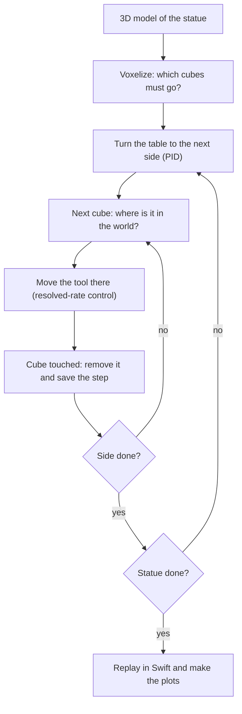

# Sculptor Robot

A Panda arm carves a statue out of a marble block that sits on a rotating table. Everything is simulated: Python and the Robotics Toolbox for the control, Swift for the 3D view.

Midterm project of *Robot Control Applications* (USI - SUPSI). Work in progress.

<!-- TODO: short looping GIF of the robot carving (docs/media/) -->

## How it works

The block is made of small cubes (voxels). We take a 3D model of the statue, and every voxel that is not part of it has to go. The robot touches those voxels one by one and they disappear. The table turns, so the robot always works on the side in front of it.



**1. Voxelize.** The model is scaled to the block and turned into cubes. Block minus statue = the cubes to remove.

**2. Turn the table.** A PID moves the table to the angle of the next side. The arm waits until the table stops.

**3. Find the cube.** Each cube is known in the block frame. With the table rotated by $\varphi$, in the world it is:

$$\mathbf{p}^W = \mathbf{T}^W_{T}\,\mathbf{R}_z(\varphi)\,\mathbf{p}^B$$

**4. Move the tool.** Closed-loop resolved-rate control drives the tool to the cube. The Panda has more joints than the task needs, so a second task in the null space keeps its posture from drifting:

$$\dot{\mathbf{q}} = \lambda \mathbf{J}^+ (\mathbf{x}^\ast - \mathbf{k}(\mathbf{q})) + (\mathbf{I} - \mathbf{J}^+\mathbf{J})\, k_0 (\mathbf{q}_r - \mathbf{q})$$

**5. Remove and save.** When the tool reaches the cube, the cube is removed and the step is saved (joints, table angle, removed cubes).

**6. Replay and compare.** The simulation runs without Swift, then the saved steps are played back in Swift. Running it with different settings gives the comparisons for the report: open vs. closed loop, with and without noise on the joints, with and without the posture task.

## Folders

```
sculptor-robot/
├── sculptor/     # our modules (cell, model, controller, carving)
├── notebooks/    # prototypes, model checks and the main notebook
├── models/       # 3D models of the statues
├── results/      # simulation output (not committed)
└── docs/         # report, slides, images
```

## Setup

The environment is the same as the course one (`rca`), plus `trimesh` for the 3D models. With [uv](https://docs.astral.sh/uv/):

```bash
uv sync
```

This creates `.venv` and installs `sculptor`, so the notebooks can just `import sculptor`. In VS Code, pick `.venv` as the notebook kernel.

## License

MIT, see [LICENSE](LICENSE).
